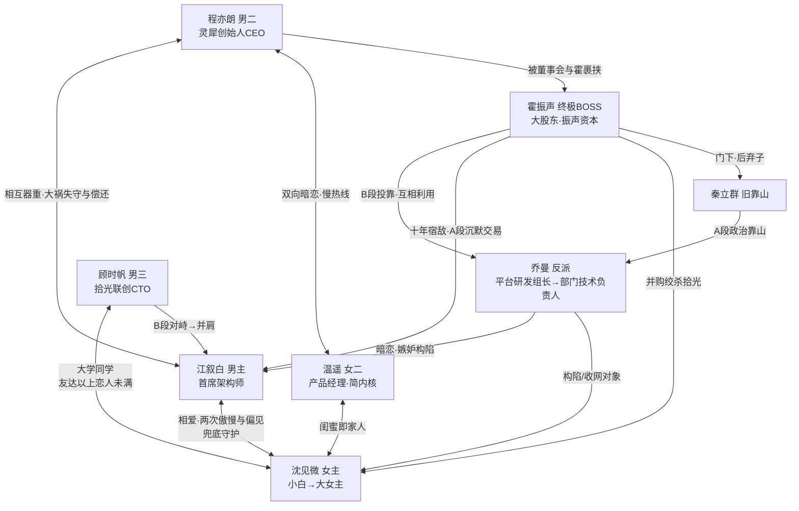

# 人物圣经（Character Bible）——《零日重逢》

> 故事项目：love-bug-code-love
> 依据：concept.md / worldbuilding.md v0.5（2026-10-30）
> 状态：待用户确认
> 命名说明：姓名为本版拟定方案，可整体替换

---

## 角色总览

| 编号 | 角色 | 姓名 | 定位 |
|---|---|---|---|
| 1 | 男主 | **江叙白** | 灵犀科技首席架构师，达西内核 |
| 2 | 女主 | **沈见微** | A 段初级工程师 → B 段拾光科技联合创始人/CEO，伊丽莎白内核 |
| 3 | 反派 | **乔曼** | 灵犀科技平台研发组组长→部门技术负责人（中层，女主的直接/隔级上级），暗恋男主，作恶引擎 |
| 4 | 终极 BOSS | **霍振声** | 灵犀大股东/资本方掌舵人，B 段最后大麻烦 |
| 5 | 男二 | **程亦朗** | 灵犀科技创始人/CEO，宾利内核 |
| 6 | 女二 | **温遥** | 女主闺蜜，灵犀产品/运营岗，简内核 |
| 7 | 男三 | **顾时帆** | 拾光科技联合创始人/CTO，女主大学同学 |
| 8 | 功能性 | 秦立群 等 | A 段反派旧靠山高管、女主同期群像 |

---

## 一、江叙白（男主，首席架构师）

### 基本档案
- **年龄**：35（A 段）→ 40（B 段，分离后第 5 年）
- **身份**：灵犀科技首席架构师，技术委员会主席；公司技术班底的旗帜
- **姓名意涵**："叙白"——陈述+清白，一个名字写完悬疑主线：他要用五年时间，把真相**叙**出来，还彼此**清白**
- **外貌**：清瘦高个，常年黑白灰基础款，眼神锐利；开会时习惯转一支旧钢笔（早年技术攻坚时期的纪念物，唯一"有故事"的私人物件）
- **语言习惯**：语速不快但句句见血，评审会上"这段代码谁写的，站出来"是全公司名场面；对女主除外——后期对她的表达笨拙、短句、绕远路（傲慢外壳下的笨拙温柔是笑点与萌点）

### 欲望-恐惧-缺陷三角
- **外在目标**：A 段——守住灵犀的技术底线与上市进程；B 段——查清当年大祸真相，还女主清白
- **内在需求**：学会低头——承认自己"看得准但说得太狠"伤过人，学会把守护用对方能接收到的方式表达出来（"兜底"而非"甜言"的转变起点）
- **最大恐惧**：自己在意的人因自己连累受损（早年怼走高管曾拖累过导师，历史重演是大祸时他扛锅的心理根因）
- **性格缺陷**：直言不讳到刻薄，把"实力即真理"当作无需解释的公理；不屑经营政治关系，导致关键时刻孤立无援
- **秘密**：大祸之夜他已查到指向乔曼的初步证据，但证据链同时威胁到霍振声的资本布局——他扛锅的实质是与霍做了一笔沉默交易：他退场，证据封存，女主免于追责与刑事移送。这是 B 段重逢时横在两人之间的"二次傲慢与偏见"：女主以为他选择了公司抛弃了她

### 成长经历与关键记忆
- 约 10 年前参与公司关键技术攻坚，一战成名；同期当面怼走高管秦立群，从此在政治派中"挂了号"
- **关键创伤**：攻坚时期敬重的导师曾因他的一次公开纠错被政治派排挤走，从此他形成"技术问题技术解决，别把人卷进来"的行事逻辑——直到女主让他明白，沉默的守护也是一种傲慢

### 人物弧光（达西内核不变律下的微弧）
A 段：高冷毒舌的导师式守护 → 相爱 → 大祸时自我牺牲扛锅（守护的第一次"错付"）→ 分离
B 段：蛰伏数年暗中留存证据 → 重逢时身份与权力结构重置，与女主二次"傲慢与偏见" → 学会把真相与爱**说出来**而不是独自兜底 → 与女主并肩收网，守护落地
**变的是表达方式与两人位置，不变的是"认定便守护一生"的内核。**

---

## 二、沈见微（女主）

### 基本档案
- **年龄**：24（A 段）→ 29（B 段，分离后第 5 年）
- **身份**：A 段灵犀科技初级后端工程师（被栽赃背锅的"透明人"）→ 分离后出国蛰伏、背负"未结案的责任认定人"身份 → B 段回国在上海联合创立拾光科技（联合创始人/CEO）
- **A 段入职与汇报线**：先入职一个与江叙白、乔曼均无人事隶属关系的项目组；与江叙白的初见、复盘交锋等交集不变。入职初期公司启动大项目，江叙白被下派到该团队分管，双方在项目风险期高频协作；项目基本稳定后，江叙白退出分管并将团队交接给乔曼。交接期乔曼察觉江叙白对沈见微的守护并产生敌意，交接完成、江叙白离开后，乔曼开始针对沈见微，接回原有构陷主线。
- **出身与居住**：外地人——老家小城（母亲在老家，靠每周一通电话/微信联系）；A 段独居于上海租的老公寓（朝北三十平，月租两千八），清晨闹钟起床、独自整理通勤的"沪漂"日常；不是上海本地人，无弄堂/板壁/同住亲属背景
- **姓名意涵**："见微"——见微知著，查真相的女主本人：从一行日志、一次提交记录里看出整个阴谋
- **外貌**：A 段马尾+工牌绳挂脖的普通小白形象，被训到眼眶发红也梗着脖子；B 段利落短发/低马尾，西装外套配运动鞋（"我赶时间"），气场全开但笑起来还是当年那个见微
- **语言习惯**：A 段嘴硬心软，"这锅我不背"是口头禅；B 段学会了资本话术，但对技术细节依然会突然切换成"较真模式"——这是江叙白认出她的方式之一

### 欲望-恐惧-缺陷三角
- **外在目标**：A 段——洗清冤屈、证明自己配得上这个职业；B 段——把拾光做起来，并查清当年真相
- **内在需求**：学会信任与借力——从"什么都自己扛、不肯示弱"到接受并肩作战（与江叙白的"学会低头"构成价值线的两半）
- **最大恐惧**：再次成为"被牺牲的那个棋子"；连累为自己出头的人（大祸时为保护江叙白主动消失的动机根因）
- **性格缺陷**：A 段——起点低却死不低头，宁可硬碰硬也不愿"会来事儿"，屡屡撞墙；把"不求人"当尊严，误读了江叙白的守护（第一次偏见）
- **秘密**：消失的几年里，她一直在用公开渠道碎片化追查大祸真相——她与江叙白是隔着时空的"双线查案人"，谁也不知道对方没放下

### 成长经历与关键记忆
- 名校（985/211）出身却混成了"好学校里的差学生"——绩点常年垫底、奖学金无缘、被辅导员约谈常客；但硬功夫全下在了课堂外：开源社区活跃贡献者，靠一个爆款开源项目被灵犀破格捞进来——"学校是她的平台，不是她的证明"
- **关键转折**：A 段单元案例中多次救火成功，从"背锅侠"积累起"事故处理女王"的行业声誉——B 段大女主地位的每一块砖都在 A 段砌好（成长须通过可外显里程碑呈现，见世界规则七）

### 人物弧光（双段式）
A 段：被栽赃背锅的硬骨头小白 → 救火中与江叙白相爱 → 大祸时为保护他主动消失（她的牺牲与他的扛锅互为镜像）
B 段：以大女主身份归来，权力结构重置（从棋子变棋手）→ 二次"傲慢与偏见"（误读江叙白当年弃她保公司）→ 并肩收网 → 达西式二次告白，两种骄傲和解
**主题呼应**："被看见的成长"——她的每一步成长都有可查证的里程碑，恰与技术作恶"必然留痕"形成叙事同构。

---

## 三、乔曼（反派，平台研发组长→部门技术负责人）

### 基本档案
- **年龄**：33（A 段）
- **身份**：灵犀科技平台研发组组长。女主入职时与其无人事隶属（女主先在无关项目组，江叙白下派分管的大项目风险期内亦无乔曼介入）；项目基本稳定、江叙白退出分管后，乔曼接管女主所在团队，成为其直接上级，A 段中期升半级为部门技术负责人（获得跨组评审权限）；后借"技术合规委员会技术秘书"之职与江叙白的工作交集渐密——构陷女主的权限便利来自接管后的上级身份，接触男主的通道则是委员会共事
- **外貌**：职场精致派，永远妆容完整、高跟鞋清脆；对上微笑对下冷脸，"茶水间最热情、评审会最刻薄"
- **语言习惯**：向上汇报滴水不漏，向下沟通绵里藏针："我不是针对你，我是对事不对人"（每次说这话都在针对人）

### 欲望-恐惧-缺陷三角
- **外在目标**：保住位子、挤进上市后的核心管理层；得到江叙白
- **内在需求**：被认可——作为女性熬到管理层，技术却撑不起位子，她比谁都清楚自己是"混上来的"，这份自我认知的空洞才是她的真正饥饿（暗恋江叙白实质是渴望通过"被强者选中"来填补自我怀疑）
- **最大恐惧**：被优化（35 岁焦虑的女性版本+能力平庸的双重恐惧）；江叙白的目光落到别人身上
- **性格缺陷**：蠢而坏——技术能力不行却嗜好办公室政治；手法粗糙（埋 bug 留痕极多），但擅长甩锅嫁祸与向上管理
- **秘密**：暗恋江叙白多年（入行初心动，多年单方面幻想"惺惺相惜"）；当年大祸的 bug 正埋在她借"帮女主 review"之名碰过的代码里——她既是构陷者，也是把男主拖入深渊的人

### 作恶动机的升级链
1. **A 段前期**：业绩焦虑+保位（基础动机，与概念卡一致）；大项目交接期，她察觉江叙白对沈见微的守护，敌意在此萌生，但风险期与交接未完成前不动手
2. **A 段中期**：交接完成、江叙白退出分管后，嫉妒与保位合流——她从挪工单甩锅开始针对沈见微，构陷从"甩锅便利"逐步升级为"定向铲除"
3. **分离段**：大祸爆发，嫁祸女主、逼走江叙白（男主扛锅正是她求之不得的结果——"他为她退场"被她扭曲解读为"她配不上他"）
4. **B 段**：投靠霍振声，从"蠢而坏的作恶者"进化为"终极 BOSS 的白手套"——技术仍不行，但政治靠山升级，作恶量级随之升级

### 人物弧光
无救赎的崩坏线：压抑暗恋与保位焦虑 → 第一次作恶得手 → 掩盖制造新破绽（世界观规则 4）→ 二次作恶、投靠霍振声 → 证据链收网，旧罪新罪一并清算

---

## 四、霍振声（终极 BOSS）

### 基本档案
- **年龄**：50+（B 段）
- **身份**：灵犀科技大股东/董事，"振声资本"创始人；B 段推动对拾光科技敌意并购的幕后操盘者
- **外貌**：儒雅长辈感，永远在"提携后辈"的姿态里谈最狠的条件；不发脾气，只"表示遗憾"
- **语言习惯**：资本语言包装一切——"这不是惩罚，是价值回归"；口头禅"年轻人，格局"

### 欲望-恐惧-缺陷三角
- **外在目标**：吞并拾光、抹平当年大祸的一切残留风险，把灵犀-拾光的版图变成自己的提款机
- **内在需求**：控制——他真正无法容忍的是"计划外的变数"（江叙白当年的顶撞、女主的不可驯服，本质都是对他秩序的冒犯）
- **最大恐惧**：大祸真相翻案引发的监管追责与资本信誉崩塌——当年那笔"沉默交易"是他最大的软肋
- **性格缺陷**：过度自信于"一切皆可交易"，低估了不要钱只要真相的人（他对江叙白的误判：以为扛锅者已被驯服）
- **秘密**：A 段大祸中他是知情受益者（借事故做掉了不听话的旧管理层数人，含推动秦立群上位又弃子）；江叙白的证据链握有他与乔曼的关键交集记录

### 结构功能（B 段最后大麻烦）
- 反派链终点：秦立群（A 段靠山）→ 霍振声（B 段新靠山/总后台），保证冲突可无限续期的结构在 B 段收口
- 终局设计：霍以敌意并购+法律诉讼+舆论战三线绞杀拾光，男女主以"证据链+商业反击+监管介入"三线破局——**并肩渡过此劫即大团圆的仪式性高潮**
- 与男主关系：十年前"被怼走的高管"秦立群本就是霍的门下——政治派的总后台从未换人，A/B 两段的对抗因此浑然一体

---

## 五、程亦朗（男二，灵犀创始人/CEO，宾利内核）

### 基本档案
- **年龄**：36（A 段）
- **身份**：灵犀科技创始人/CEO；约 10 年前于上海创办灵犀（"心有灵犀、连接万物"）
- **外貌**：温和俊朗，休闲西装不打领带，笑起来没架子，全公司唯一敢拍江叙白肩膀的人
- **语言习惯**：口头禅"都有得谈"；对温遥讲话会不自觉放慢语速、变轻

### 欲望-恐惧-缺陷三角
- **外在目标**：把灵犀带上市，兑现给投资人和团队的承诺
- **内在需求**：学会在"好人人设"与"掌舵人的决断"之间立住——宾利式缺陷的当代版：太在意所有人都满意，关键时刻会被董事会意志左右
- **最大恐惧**：公司毁在自己心软/误判上
- **性格缺陷**：随和易被左右——大祸定责时被霍振声与董事会裹挟，默认了牺牲江叙白的方案（宾利"被达西劝退简"情节的镜像：他被资本"劝退"了公道），事后多年愧疚
- **秘密**：对温遥一见倾心多年未言明（宾利式的"不知对方心意，不敢贸然"）

### 人物弧光
A 段：知人善任的温和老板 → 大祸时软弱失守（结构上促成男主孤立）→ 愧疚蛰伏
B 段：在灵犀与拾光的并购博弈中终于"站对不站稳"——把关键证据/资源递到女主手中，完成对当年失守的偿还；与温遥慢热线在 B 段收束（简与宾利的"终于确认彼此心意"）

---

## 六、温遥（女二，简内核）

### 基本档案
- **年龄**：25（A 段）
- **身份**：灵犀产品经理，女主入职后的第一位饭搭子，后成闺蜜
- **外貌**：温柔挂，说话轻、笑意浅，情绪几乎不外露；只有女主知道她哭的时候会一个人去楼梯间
- **语言习惯**：口头禅"没事的"（说给自己听的次数多于说给别人）；对程亦朗永远客气而克制

### 欲望-恐惧-缺陷三角
- **外在目标**：把产品做好、守住闺蜜（女主大祸时的外部信息通道与情感支点）
- **内在需求**：学会表达——简式困境：把深情藏得连当事人都察觉不到，错位的克制误伤彼此
- **最大恐惧**：表露真心后被辜负；更怕闺蜜和自己喜欢的人之间被迫二选一
- **性格缺陷**：被动——感情里永远等对方先迈步，职场里吃"不会为自己争取"的暗亏（与女主"死不低头"形成双女主性格对照）
- **秘密**：A 段起就察觉程亦朗的心意，也清楚自己的，但她是女主闺蜜、他是老板——阶层与身份的顾虑让她选择装作不知

### 人物弧光
A 段：深情深藏的助攻闺蜜（为主角感情推波助澜，自己按兵不动）
分离段：成为女主消失前托付的人（留守灵犀的"内应"伏笔）
B 段：在灵犀-拾光对峙中夹在程亦朗与女主之间，被迫直面"藏不住了"→ 表达与和解，简与宾利的圆满结局

---

## 七、顾时帆（男三，拾光联合创始人/CTO）

### 基本档案
- **年龄**：24（A 段），与女主同届；与女主是大学同学——同一所名校，他是标准意义的"好学生"（绩点前排、保研路子、大厂 offer 拿到手软），她是他眼里"最可惜的那种差学生"——直到看见她的开源项目才明白什么叫"分数量不出的人"
- **身份**：A 段后期从大厂辞职陪女主创立拾光科技，任联合创始人/CTO（"一个人创业太苦了"——女主的创业合法性支撑）；他放弃的东西越体面，这份投奔的分量越重
- **外貌**：连帽衫+双肩包的永远的工程师样子，笑起来有虎牙，和女主合影永远是"损友式互怼"站位
- **语言习惯**：对女主的称呼从大学时代的"小微"到创业后的"微姐"（互怼专用）；口头禅"行，我改"（技术上是真改）

### 欲望-恐惧-缺陷三角
- **外在目标**：把拾光的技术做成行业标杆，护住女主的心血
- **内在需求**：认清自己的位置——大学时就是唯一看好她的同学，可以是她最信任的战友，而这段关系不必有别的名分
- **最大恐惧**：女主因当年大祸彻底垮掉（辞职陪创业的动机）；以及重逢后——江叙白回来，拾光失去"他以为的家"的形状
- **性格缺陷**：用插科打诨回避一切严肃情感表达（B 段重逢时对江叙白的敌意半真半假，"真"的那半他自己都不敢细看）

### 感情设定：友达以上，恋人未满
- 与女主之间是**双向无自觉的暧昧边界感**——从大学实验室熬夜赶 Due 的默契，到创业搭档的信任，两人自己都说不清那是什么，也从未挑明（"友达以上"）
- 女主心里始终有一个人的位置，他清楚；他自己也从未越过那条线（"恋人未满"不是错过，而是"有些关系不需要答案"）
- **正剧处理**：B 段重逢风波中，这段关系一度被外界（及他自己）拿放大镜检视，但他最终主动把它**定格在"未满"**——轻盈不苦情的成全，与反派乔曼"因爱生恨毁人所爱"无镜像关联（乔曼是执念，他是清醒）
- **番外钩子（席绢式结尾）**：正剧大团圆收束时留开放式暖尾——番外中给顾时帆安排一次"意外的心动对象"（新人物只露剪影：拾光的天使投资人/行业大会上偶遇的同行），止于"这次，他想知道答案"——配角的春天在故事结束后悄然开始的余韵，为续作/番外留独立感情线接口

### 人物弧光
A 段后期：仗义出走的兄弟，陪她从零创业
B 段：重逢风波中关系被检视 → 主动定格"友达以上"→ 以拾光 CTO 身份成为大团圆结局的班底成员 → 番外开启属于自己的故事
**写作纪律**：正剧零三角拉扯、零狗血误会；他的价值在"战友"与"清醒的成全"，番外再谈"心动"。

---

## 八、功能性角色（从简）

- **秦立群**（A 段反派旧靠山）：灵犀事业部总经理/CTO 线高管，霍振声门下；男主十年前怼走的那位。A 段大祸定责时打压男主的关键手，B 段被霍弃子。档案止于此。
- **女主同期群像**（2-3 人，A 段命名从简、可按单元案例需要扩展）：A 段单元案例参与者与温情来源；B 段女主班底雏形。
- **霍振声的并购团队/律所**：B 段三线绞杀的执行面孔，工具人。

---

## 九、人物关系

### 关系描述

- **江叙白 ⇄ 沈见微**：达西与伊丽莎白。两次"傲慢与偏见"（A 段他轻慢她的起点/她误读他的毒舌；B 段她误读他的扛锅/他误读她的消失），两次和解；内核是"兜底式守护"与"被看见的成长"互相成全。
- **乔曼 → 江叙白**：单向暗恋+职业嫉妒的扭曲混合体。她构陷女主既是铲除情敌，也是对"他居然会为一个人退场"的报复性不能接受。
- **乔曼 → 沈见微**：A 段构陷者与受害者；B 段猎物反猎——收网主线。
- **江叙白 ⇄ 程亦朗**：技术灵魂与掌舵人，相互器重的君子之交；大祸时程的失守是男主心结之一，B 段偿还。
- **程亦朗 ⇄ 温遥**：宾利与简。双向暗恋、双双克制，慢热线，B 段收束。
- **沈见微 ⇄ 温遥**：闺蜜即家人；女主消失时期的托付与留守内应。
- **沈见微 ⇄ 顾时帆**：大学同学、创业搭档，"友达以上，恋人未满"；他信她无保留（好学生押注差学生的那种笃定），她信他无保留；正剧定格于此，番外留他的独立故事。
- **乔曼 ⇄ 霍振声**：B 段投靠关系——白手套与总后台，互相利用，弃子收场。
- **霍振声 ⇄ 江叙白**：跨越 A/B 两段的宿敌总对决（借秦立群的前史使 A/B 两段对抗一体化）。
- **江叙白 ⇄ 顾时帆**：B 段微妙的对峙→并肩。男三对男主的敌意与释然，是"守护的正当性"的第三方见证。

### 关系图

### 悬疑线关键信息差（查真相骨架的人物侧配置）

| 事实 | 知道的人 | 不知道的人（关键项） |
|---|---|---|
| 大祸 bug 是乔曼所埋 | 乔曼、（部分线索）江叙白、霍振声 | 沈见微（B 段逐步查明）、程亦朗、温遥 |
| 江叙白扛锅是与霍的沉默交易 | 江叙白、霍振声 | 沈见微（B 段中期揭晓，二次偏见的解药）、乔曼（不知全貌） |
| 女主消失是主动保护江叙白 | 沈见微 | 江叙白（B 段重逢后才理解）、所有人 |
| 顾时帆与女主"友达以上"的边界感 | 顾时帆（一半）、沈见微（另一半） | 江叙白（B 段初期的微妙紧张源，释然后见证守护正当性）、所有人 |
| 温遥留守灵犀是受女主所托 | 温遥、沈见微 | 程亦朗、江叙白 |

> 写作纪律：按世界规则 6，已揭晓事实不许回退；信息差只允许"逐步收窄"。

---

## 修订记录

| 日期 | 版本 | 说明 |
|---|---|---|
| 2026-10-30 | v0.1 | 初稿：8 组角色档案、弧光、关系图与信息差矩阵，待用户确认 |
| 2026-10-30 | v0.2 | 男主定名江叙白、女主定名沈见微（含姓名意涵）；男三顾时帆感情线由"克制暗恋+释然成全"改为"友达以上恋人未满"，正剧定格+番外独立感情线钩子（席绢式开放式暖尾）；男二定名姜亦朗（避免与女主同姓） |
| 2026-10-30 | v0.3 | 女主改姓定名沈见微；男二改回程亦朗（同姓冲突随女主改姓消除） |
| 2026-10-30 | v0.4 | 女主学历起点由"二本+自学"改为"名校差学生"（课堂外硬功夫+开源项目破格入职，学校是平台不是证明）；顾时帆由"青梅竹马/发小"改为"大学同学"（同校好学生，唯一看好她的同学，辞职陪创业的分量更重） |
| 2026-10-30 | v0.5 | 一致性修订：乔曼职级由"平台技术总监（与男主平级）"改为"平台研发组组长→部门技术负责人（中层，女主直接/隔级上级）"，对齐 worldbuilding；顾时帆年龄改 24（与女主同届）；江叙白沉默交易豁免升为"免于追责与刑事移送"，对齐 disaster v0.2；沈见微补出国蛰伏+"未结案的责任认定人"身份+回国于上海创立拾光；时间跨度锁定 5 年（B 段年龄同步收紧）；"十年宿敌"改"跨两段宿敌"；修订记录行序修正；头部依据版本号更新 |
| 2026-11-02 | v0.6 | 女主人设修订（去"上海弄堂本地人"背景）：沈见微为外地人，老家小城母亲远程联系，A 段独居上海租的老公寓（沪漂设定）；同步修订正文第 1、11、21、28、52、63 章（第 63 章标题"弄堂来电"→"老家来电"）与 chapters.md v1.4 |
| 2026-11-07 | v0.7 | 入职线修订：沈见微先入职与江叙白、乔曼均无关的项目组；入职初期的大项目由江叙白下派分管，风险期高频协作（无甩锅），项目稳定后交接给乔曼；交接期乔曼察觉江对沈的守护而生敌意，接管后开始针对沈见微（挪工单背锅等原有构陷线移至交接后，接回原故事线）。同步修订沈见微"A 段入职与汇报线"、乔曼身份与作恶动机链；其余人设不变 |
| 2026-11-13 | v0.8 | 称呼规范定名（去"某工"化，详见 update-log 变更 #4/#5）：正文中无全名的功能性配角定名——方工→方姐（女架构师/技术委员会）、涂工→老涂、阚工→老阚、洪工→老洪、周工→老周（《一百二十七扇门》受访者，≠周昊）、程工→老程、严工/陈工→与既有老严/老陈统一、冯工→老冯、佟工→老佟、陆工→陆老（容灾泰斗）、顾工→顾时帆、林工→林霜、岑工→岑远（新起全名）、孟工→孟青（新起全名）、阮工→小阮（顾时帆番外线）；沈工→见微；高工=职称（老张）保留 |
